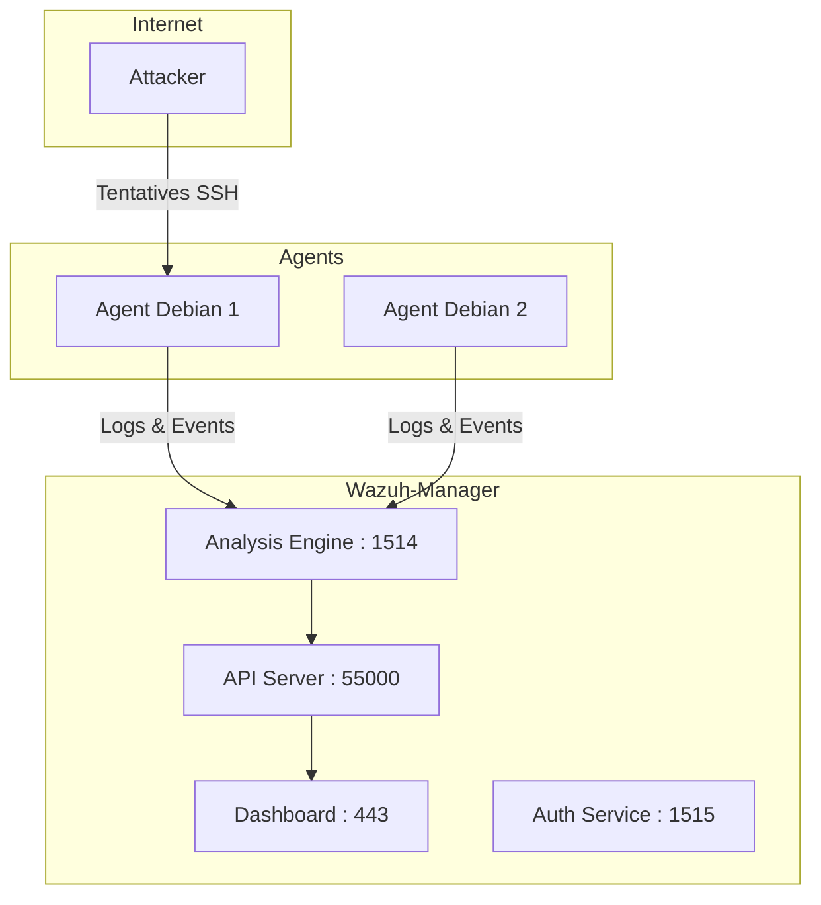

<!-- MASTER-HEADER-START -->
<div align="center">

<a href="https://0xcyberlitech.com/">
  
</a>

<p align="center">
  <a href="https://0xcyberlitech.com/"></a>
  <a href="https://0xcyberlitech.com/soc-rd.html"></a>
  <a href="https://0xcyberlitech.com/jarvis-rd.html"></a>
  <a href="https://github.com/0xCyberLiTech?tab=repositories"></a>
</p>
<p align="center">
  <a href="README.md"></a>
</p>


</div>
<!-- MASTER-HEADER-END -->

<!-- DEBIAN-TRUTH-START -->
> [!IMPORTANT]
>  ** Matrice Officielle Debian — `Debian 12 (Bookworm)` · `Debian 13 (Trixie)` · `Debian 14 (Forky)`**
> - **Sources Officielles Debian.org (`nftables`) :** `Bookworm (12)` : **`1.0.6-2+deb12u2`** &nbsp;·&nbsp; `Trixie (13 — Stable)` : **`1.1.3-1`** &nbsp;·&nbsp; `Forky (14 — Next-Gen)` : **`1.1.7-3`**
> - **Références Officielles :** [Paquet Debian Trixie (`nftables`)](https://packages.debian.org/trixie/nftables) &nbsp;·&nbsp; [Paquet Debian Forky (`nftables`)](https://packages.debian.org/forky/nftables) &nbsp;·&nbsp; [Documentation Officielle Debian](https://wiki.debian.org/Hardening)
> - **Note d'Ingénierie (Divergence 13 vs 14) :** Sous Debian 13 (Trixie) et Debian 14 (Forky), `net-tools` (`ifconfig`, `netstat`) et `iptables` sont définitivement remplacés par `iproute2` (`ip`, `ss`), `nftables`, `AppArmor` et `journalctl`.

<details>
<summary> <b>Afficher les Encarts Ligne de Commande : Debian 13 (Trixie — Stable) vs Debian 14 (Forky — Next-Gen)</b></summary>

####  Profil Production Stable — Commandes pour `Debian 13 (Trixie)`
```bash
# Debian 13 (Trixie) — Audit des ports en ecoute (iproute2) & pare-feu nftables :
ss -tulpn && ip -c a
sudo nft list ruleset && sudo journalctl -u ssh -n 50 --no-hostname
```

####  Profil Anticipation Next-Gen — Commandes pour `Debian 14 (Forky)`
```bash
# Debian 14 (Forky) — Audit de durcissement systemd & AppArmor actif par defaut :
sudo aa-status
systemd-analyze security | grep -E 'EXPOSED|UNSAFE'
```

</details>
<!-- DEBIAN-TRUTH-END -->

<!-- CIEL-PEDAGOGY-START -->
<details>
<summary> <b>Synthèse d'Architecture, Standards Officiels &amp; Diagnostic (Niveau 1 : Fondamentaux · Niveau 2 : Repères · Niveau 3 : Diagnostic)</b></summary>

- **Niveau 1 — Fondamentaux &amp; Principe d'Architecture :** L'ingénierie de **Cybersécurité & Défense en Profondeur (*Defense-in-Depth*)** superpose des barrières de sécurité complémentaires : réduction de la surface d'attaque, durcissement du noyau (`sysctl`), filtrage réseau **Nftables**, détection d'intrusion **Suricata (IDS/IPS)** et remédiation comportementale **CrowdSec / Fail2ban**.
- **Niveau 2 — Repères Officiels (Ports IANA, Fichiers Debian &amp; Commandes de Validation) :** **Commandes de contrôle :** `ss -tulnp` (Audit des sockets en écoute) · `sudo suricata -T -c /etc/suricata/suricata.yaml` (Test syntaxique IDS) · `sudo cscli metrics` (État CrowdSec) · `sudo sysctl --system`.
- **Niveau 3 — Diagnostic d'Incidents &amp; Ingénierie Avancée :** **Diagnostic & Architecture :** Un système **IDS** (*Intrusion Detection System*) analyse le trafic pour lever des alertes qualifiées, tandis qu'un système **IPS** (*Intrusion Prevention System*) ou un bouncer pare-feu intercepte et bloque activement les adresses IP malveillantes au niveau de la couche Netfilter/Nftables.
- **Sources de Vérité Officielles Éditeurs &amp; Standards :** [Guides Officiels ANSSI (Durcissement Linux)](https://cyber.gouv.fr/) &nbsp;·&nbsp; [Documentation Officielle Suricata](https://docs.suricata.io/) &nbsp;·&nbsp; [Documentation Officielle CrowdSec](https://docs.crowdsec.net/)

</details>
<!-- CIEL-PEDAGOGY-END -->


#  TP — Wazuh : Installation et Tests en Lab (Debian 12 & 13)

> **Licence :** Wazuh est 100% **gratuit et open-source** (GPLv2 / Apache 2.0).  
> Aucune fonctionnalité payante n’est cachée. Le support commercial existe mais reste optionnel.

---

##  01 // 1) Introduction à Wazuh


- **Nature :** SIEM + EDR/XDR open source.  
- **Fonctions clés :**  
  - Collecte et corrélation de journaux.  
  - Détection d’intrusion et vulnérabilités.  
  - Surveillance de l’intégrité des fichiers (FIM).  
  - Tableaux de bord de conformité (PCI, GDPR, HIPAA, NIST).  
  - Réponse active (blocage IP, alertes).  

---

##  02 // 2) Architecture simplifiée


###  Schéma global (Manager + Agents)



 **Résumé :** 
- Les **agents** envoient leurs journaux au **Manager** (port 1514).  
- Le **Manager** corrèle, détecte, applique des réponses actives.  
- L’**API** (55000) expose les données au **Dashboard** (443).  
- L’**enrôlement des agents** passe par le port 1515.

---

##  03 // 3) Préparation (Debian 12/13)


###  3.1 Prérequis système
- OS : Debian 12 (Bookworm) ou Debian 13 (Trixie).  
- Ressources minimales : **4 vCPU / 8 Go RAM / 50 Go disque** (lab ≤ 25 agents).  
- Accès root/sudo et Internet sortant.  

###  3.2 Mise à jour + dépendances

<!-- CODE-WINDOW-START -->
> [!CAUTION]
> 
>
> ```bash
> sudo apt-get update && sudo apt-get upgrade -y
> sudo apt-get install -y curl gnupg lsb-release ufw chrony
> ```
<!-- CODE-WINDOW-END -->

###  3.3 Pare-feu conseillé (UFW)

<!-- CODE-WINDOW-START -->
> [!CAUTION]
> 
>
> ```bash
> sudo ufw allow 443/tcp    # Dashboard
> sudo ufw allow 1514/tcp   # Agent -> Manager
> sudo ufw allow 1515/tcp   # Enrôlement agent
> sudo ufw allow 55000/tcp  # API Server
> sudo ufw enable
> ```
<!-- CODE-WINDOW-END -->

---

##  04 // 4) Installation du serveur Wazuh (all-in-one)


###  4.1 Script officiel

<!-- CODE-WINDOW-START -->
> [!CAUTION]
> 
>
> ```bash
> curl -sO https://packages.wazuh.com/4.12/wazuh-install.sh
> sudo bash ./wazuh-install.sh -a
> ```
<!-- CODE-WINDOW-END -->

 **Résultat attendu :** affichage du mot de passe `admin`.

###  4.2 Accès au Dashboard
- URL : `https://<IP_SERVEUR>`  
- Identifiant : `admin` / mot de passe généré.

---

##  05 // 5) Ajout d’un agent Debian


###  5.1 Installer l’agent
Sur la machine cliente :

<!-- CODE-WINDOW-START -->
> [!CAUTION]
> 
>
> ```bash
> curl -s https://packages.wazuh.com/key/GPG-KEY-WAZUH |   sudo gpg --no-default-keyring --keyring gnupg-ring:/usr/share/keyrings/wazuh.gpg --import
>
> echo "deb [signed-by=/usr/share/keyrings/wazuh.gpg] https://packages.wazuh.com/4.x/apt/ stable main"   | sudo tee /etc/apt/sources.list.d/wazuh.list
>
> sudo apt-get update
>
> WAZUH_MANAGER="IP_DU_MANAGER" sudo apt-get install -y wazuh-agent
> sudo systemctl enable --now wazuh-agent
> ```
<!-- CODE-WINDOW-END -->

###  5.2 Vérification

<!-- CODE-WINDOW-START -->
> [!CAUTION]
> 
>
> ```bash
> sudo systemctl status wazuh-agent
> ```
<!-- CODE-WINDOW-END -->

Agent doit être en **active (running)**.

---

##  06 // 6) Scénarios de test labo


###  6.1 Brute force SSH
- Tentez plusieurs connexions SSH invalides vers l’agent.  
- Attendez la génération d’alertes dans le Dashboard.

###  6.2 Intégrité fichiers (FIM)
- Modifiez `/etc/hosts` sur l’agent Debian.  
- Une alerte FIM doit apparaître.

###  6.3 Test antivirus (EICAR)
- Créez `/tmp/eicar.com` avec la signature EICAR standard.  
- Déclenchement attendu : alerte de détection malware.

###  6.4 Active Response
- Avec Active Response activé, un brute force SSH peut déclencher un blocage IP automatique.  
- Vérifiez que l’IP source est bannie.

---

##  07 // 7) Exploration du Dashboard


Sans capture, voici les principaux modules à consulter :

- **Vulnérabilités** : liste des packages vulnérables détectés sur les agents.  
- **Conformité (PCI, GDPR, NIST, HIPAA)** : règles d’audit et scoring.  
- **Threat Hunting (MITRE ATT&CK)** : mappage des alertes à la matrice MITRE.  
- **Règles et décodeurs** : gestion de la logique de détection.  
- **Logs & Recherche** : moteur de recherche pour analyser les événements collectés.  

---

##  08 // 8) Désinstallation


###  Serveur

<!-- CODE-WINDOW-START -->
> [!CAUTION]
> 
>
> ```bash
> sudo bash ./wazuh-install.sh -u
> ```
<!-- CODE-WINDOW-END -->

###  Agent

<!-- CODE-WINDOW-START -->
> [!CAUTION]
> 
>
> ```bash
> sudo systemctl stop wazuh-agent
> sudo apt-get purge -y wazuh-agent
> sudo rm -rf /var/ossec
> ```
<!-- CODE-WINDOW-END -->

---

##  09 // 9) Points pratiques labo


- Utilisez des **snapshots de VM** pour rejouer les tests.  
- Ne pas exposer directement le Dashboard sur Internet sans proxy inverse + SSL.  
- Sauvegardez `wazuh-install-files.tar` (certificats initiaux + mots de passe).  
- Déployer le Manager plutôt sur Debian 12 pour plus de stabilité (Debian 13 encore jeune).  

---

##  Conclusion


- Wazuh = **SIEM/EDR complet open source**.  
- Installation rapide avec le script officiel.  
- Agents simples à enrôler.  
- Fonctionnalités testables en lab : brute-force SSH, FIM, malware, active response.  
- Dashboard riche : vulnérabilités, conformité, MITRE, hunting.  

 Vous disposez maintenant d’un **environnement de test opérationnel** pour apprendre la détection et la réponse sécurité.

---

##  Références utiles


- [Quickstart Wazuh](https://documentation.wazuh.com/current/quickstart.html)  
- [Dashboard navigation](https://documentation.wazuh.com/current/user-manual/wazuh-dashboard/navigating-the-wazuh-dashboard.html)  
- [Agents install](https://documentation.wazuh.com/current/installation-guide/wazuh-agent/)  
- [Ports par défaut](https://documentation.wazuh.com/current/user-manual/agent/agent-enrollment/requirements.html)  
- [Livre blanc (Licence)](https://wazuh.com/resources/white-paper/)  

<!-- MASTER-FOOTER-START -->
<div align="center">


<a href="https://0xcyberlitech.com/">
  
</a>

<p align="center"><a href="https://0xcyberlitech.com/"></a></p>

<sub><b>Architecturé &amp; Forgé par Marc &amp; Antigravity (Google DeepMind)</b> &nbsp;·&nbsp; <a href="https://0xcyberlitech.com/"><b>0xcyberlitech.com</b></a> &nbsp;·&nbsp; <a href="https://0xcyberlitech.com/soc-rd.html">Architecture SOC Cockpit v5.5</a> &nbsp;·&nbsp; <a href="https://0xcyberlitech.com/jarvis-rd.html">Architecture JARVIS Mark-VII</a> &nbsp;·&nbsp; <a href="https://0xcyberlitech.com/blueprint-jarvis.html">Blueprint Matériel RTX 5080</a></sub>

</div>
<!-- MASTER-FOOTER-END -->
