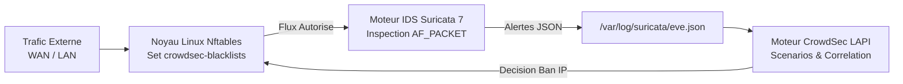

<!-- MASTER-HEADER-START -->
<div align="center">

<a href="https://0xcyberlitech.com/">
  
</a>

<p align="center">
  <a href="https://0xcyberlitech.com/"></a>
  <a href="https://0xcyberlitech.com/soc-rd.html"></a>
  <a href="https://0xcyberlitech.com/jarvis-rd.html"></a>
  <a href="https://github.com/0xCyberLiTech?tab=repositories"></a>
</p>
<p align="center">
  <a href="README.md"></a>
</p>


</div>
<!-- MASTER-HEADER-END -->

<!-- DEBIAN-TRUTH-START -->
> [!IMPORTANT]
>  ** Matrice Officielle Debian — `Debian 12 (Bookworm)` · `Debian 13 (Trixie)` · `Debian 14 (Forky)`**
> - **Sources Officielles Debian.org (`nftables`) :** `Bookworm (12)` : **`1.0.6-2+deb12u2`** &nbsp;·&nbsp; `Trixie (13 — Stable)` : **`1.1.3-1`** &nbsp;·&nbsp; `Forky (14 — Next-Gen)` : **`1.1.7-3`**
> - **Références Officielles :** [Paquet Debian Trixie (`nftables`)](https://packages.debian.org/trixie/nftables) &nbsp;·&nbsp; [Paquet Debian Forky (`nftables`)](https://packages.debian.org/forky/nftables) &nbsp;·&nbsp; [Documentation Officielle Debian](https://wiki.debian.org/Hardening)
> - **Note d'Ingénierie (Divergence 13 vs 14) :** Sous Debian 13 (Trixie) et Debian 14 (Forky), `net-tools` (`ifconfig`, `netstat`) et `iptables` sont définitivement remplacés par `iproute2` (`ip`, `ss`), `nftables`, `AppArmor` et `journalctl`.

<details>
<summary> <b>Afficher les Encarts Ligne de Commande : Debian 13 (Trixie — Stable) vs Debian 14 (Forky — Next-Gen)</b></summary>

####  Profil Production Stable — Commandes pour `Debian 13 (Trixie)`
```bash
# Debian 13 (Trixie) — Audit des ports en ecoute (iproute2) & pare-feu nftables :
ss -tulpn && ip -c a
sudo nft list ruleset && sudo journalctl -u ssh -n 50 --no-hostname
```

####  Profil Anticipation Next-Gen — Commandes pour `Debian 14 (Forky)`
```bash
# Debian 14 (Forky) — Audit de durcissement systemd & AppArmor actif par defaut :
sudo aa-status
systemd-analyze security | grep -E 'EXPOSED|UNSAFE'
```

</details>
<!-- DEBIAN-TRUTH-END -->

<!-- CIEL-PEDAGOGY-START -->
<details>
<summary> <b>Synthèse d'Architecture, Standards Officiels &amp; Diagnostic (Niveau 1 : Fondamentaux · Niveau 2 : Repères · Niveau 3 : Diagnostic)</b></summary>

- **Niveau 1 — Fondamentaux &amp; Principe d'Architecture :** L'ingénierie de **Cybersécurité & Défense en Profondeur (*Defense-in-Depth*)** superpose des barrières de sécurité complémentaires : réduction de la surface d'attaque, durcissement du noyau (`sysctl`), filtrage réseau **Nftables**, détection d'intrusion **Suricata (IDS/IPS)** et remédiation comportementale **CrowdSec / Fail2ban**.
- **Niveau 2 — Repères Officiels (Ports IANA, Fichiers Debian &amp; Commandes de Validation) :** **Commandes de contrôle :** `ss -tulnp` (Audit des sockets en écoute) · `sudo suricata -T -c /etc/suricata/suricata.yaml` (Test syntaxique IDS) · `sudo cscli metrics` (État CrowdSec) · `sudo sysctl --system`.
- **Niveau 3 — Diagnostic d'Incidents &amp; Ingénierie Avancée :** **Diagnostic & Architecture :** Un système **IDS** (*Intrusion Detection System*) analyse le trafic pour lever des alertes qualifiées, tandis qu'un système **IPS** (*Intrusion Prevention System*) ou un bouncer pare-feu intercepte et bloque activement les adresses IP malveillantes au niveau de la couche Netfilter/Nftables.
- **Sources de Vérité Officielles Éditeurs &amp; Standards :** [Guides Officiels ANSSI (Durcissement Linux)](https://cyber.gouv.fr/) &nbsp;·&nbsp; [Documentation Officielle Suricata](https://docs.suricata.io/) &nbsp;·&nbsp; [Documentation Officielle CrowdSec](https://docs.crowdsec.net/)

</details>
<!-- CIEL-PEDAGOGY-END -->


#  Architecture Cyberdéfense Active : IDS/IPS Suricata 7, CrowdSec & Bouncer Nftables sur Debian 12, 13 (Trixie) & 14 (Forky)

> **Objectif Opérationnel :** Déployer une chaîne de défense périmétrique active sous **Debian 12 (Bookworm)**, **Debian 13 (Trixie — Stable)** et **Debian 14 (Forky — Next-Gen)** combinant l'inspection réseau profonde **Suricata 7 (`AF_PACKET`)**, l'analyse comportementale **CrowdSec** sur le flux JSON `eve.json` et le blocage automatique en temps constant `O(1)` dans le pare-feu noyau **Nftables**.

<div align="center">

| Niveau | Étape Technique | Accès Direct |
|:---:|:---|:---:|
| **Niveau 1** | Architecture de corrélation Suricata (`eve.json`) → CrowdSec → Nftables | [](#architecture-suricata-crowdsec-nftables) |
| **Niveau 2** | Installation et configuration haute performance de Suricata 7 (`AF_PACKET`) | [](#installation-configuration-suricata) |
| **Niveau 2** | Déploiement de CrowdSec et acquisition du flux `eve.json` | [](#integration-crowdsec-eve-json) |
| **Niveau 3** | Activation du Bouncer Nftables (`crowdsec-firewall-bouncer-nftables`) & Audit | [](#activation-bouncer-nftables-audit) |

</div>

---

<a id="architecture-suricata-crowdsec-nftables"></a>
##  01 // Architecture de corrélation Suricata (eve.json) vers CrowdSec & Nftables


Associés sur une passerelle ou un serveur exposé, **Suricata**, **CrowdSec** et **Nftables** forment une boucle de rétroaction déterministe :

- **Suricata 7 (`suricata.service`)** inspecte les paquets réseau en temps réel via les règles *Emerging Threats Open* et consigne chaque alerte structurée dans `/var/log/suricata/eve.json`.
- **CrowdSec (`crowdsec.service`)** parse en continu `/var/log/suricata/eve.json` ainsi que `/var/log/auth.log`, corrèle les scénarios d'attaque (scans de ports, exploits CVE, brute-force) et inscrit les décisions de bannissement dans son API locale (`LAPI`).
- **Le Bouncer Nftables (`crowdsec-firewall-bouncer.service`)** maintient dynamiquement un ensemble noyau (`nft set`) rejetant instantanément les paquets des adresses IP bannies avant même qu'ils n'atteignent les services applicatifs.



---

<a id="installation-configuration-suricata"></a>
##  02 // Installation et configuration haute performance de Suricata 7 (AF_PACKET)


Installez **Suricata** et l'outil officiel de gestion des flux de signatures `suricata-update` depuis les dépôts officiels Debian :

<!-- CODE-WINDOW-START -->
> [!CAUTION]
> 
>
> ```bash
> sudo apt update
> sudo apt install -y suricata suricata-update jq nftables
> ```
<!-- CODE-WINDOW-END -->

Identifiez votre interface réseau principale (`ip -c -br link`) puis configurez la variable `HOME_NET` et l'interface d'écoute `af-packet` dans `/etc/suricata/suricata.yaml` :

<!-- CODE-WINDOW-START -->
> [!CAUTION]
> 
>
> ```yaml
> vars:
>   address-groups:
>     HOME_NET: "[192.168.0.0/16,10.0.0.0/8,172.16.0.0/12]"
>     EXTERNAL_NET: "!$HOME_NET"
>
> af-packet:
>   - interface: eth0
>     cluster-id: 99
>     cluster-type: cluster_flow
>     defrag: yes
>     use-mmap: yes
>     tpacket-v3: yes
> ```
<!-- CODE-WINDOW-END -->

Téléchargez le jeu de règles officiel *Emerging Threats Open*, validez la configuration à blanc avec l'option `-T` et redémarrez le service :

<!-- CODE-WINDOW-START -->
> [!CAUTION]
> 
>
> ```bash
> sudo suricata-update
> sudo suricata -T -c /etc/suricata/suricata.yaml -v
> sudo systemctl enable --now suricata
> ```
<!-- CODE-WINDOW-END -->

---

<a id="integration-crowdsec-eve-json"></a>
##  03 // Déploiement de CrowdSec et acquisition du flux eve.json


Installez le moteur **CrowdSec** et ajoutez la collection officielle de décodage et de scénarios dédiée à **Suricata** :

<!-- CODE-WINDOW-START -->
> [!CAUTION]
> 
>
> ```bash
> sudo apt install -y crowdsec
> sudo cscli collections install crowdsecurity/linux crowdsecurity/sshd crowdsecurity/suricata
> ```
<!-- CODE-WINDOW-END -->

Déclarez la lecture temps réel du fichier `/var/log/suricata/eve.json` dans `/etc/crowdsec/acquis.d/suricata.yaml` :

<!-- CODE-WINDOW-START -->
> [!CAUTION]
> 
>
> ```yaml
> filenames:
>   - /var/log/suricata/eve.json
> labels:
>   type: suricata
> ```
<!-- CODE-WINDOW-END -->

Rechargez CrowdSec et vérifiez que le fichier `eve.json` apparaît bien dans les métriques d'acquisition :

<!-- CODE-WINDOW-START -->
> [!CAUTION]
> 
>
> ```bash
> sudo systemctl reload crowdsec
> sudo cscli metrics show acquisition
> ```
<!-- CODE-WINDOW-END -->

---

<a id="activation-bouncer-nftables-audit"></a>
##  04 // Activation du Bouncer Nftables (crowdsec-firewall-bouncer-nftables) & Audit


Installez le bouncer officiel dédié à **Nftables** afin que chaque décision de bannissement prise par CrowdSec soit injectée dans une table `nft` dédiée :

<!-- CODE-WINDOW-START -->
> [!CAUTION]
> 
>
> ```bash
> sudo apt install -y crowdsec-firewall-bouncer-nftables
> sudo systemctl enable --now crowdsec-firewall-bouncer
> ```
<!-- CODE-WINDOW-END -->

Contrôlez la présence des ensembles dynamiques IPv4/IPv6 dans Nftables et la liste des décisions actives :

<!-- CODE-WINDOW-START -->
> [!CAUTION]
> 
>
> ```bash
> sudo nft list table ip crowdsec
> sudo cscli decisions list
> sudo cscli alerts list -l 10
> ```
<!-- CODE-WINDOW-END -->

<!-- MASTER-FOOTER-START -->
<div align="center">


<a href="https://0xcyberlitech.com/">
  
</a>

<p align="center"><a href="https://0xcyberlitech.com/"></a></p>

<sub><b>Architecturé &amp; Forgé par Marc &amp; Antigravity (Google DeepMind)</b> &nbsp;·&nbsp; <a href="https://0xcyberlitech.com/"><b>0xcyberlitech.com</b></a> &nbsp;·&nbsp; <a href="https://0xcyberlitech.com/soc-rd.html">Architecture SOC Cockpit v5.5</a> &nbsp;·&nbsp; <a href="https://0xcyberlitech.com/jarvis-rd.html">Architecture JARVIS Mark-VII</a> &nbsp;·&nbsp; <a href="https://0xcyberlitech.com/blueprint-jarvis.html">Blueprint Matériel RTX 5080</a></sub>

</div>
<!-- MASTER-FOOTER-END -->
